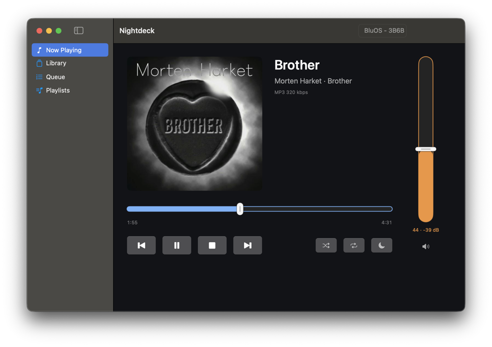
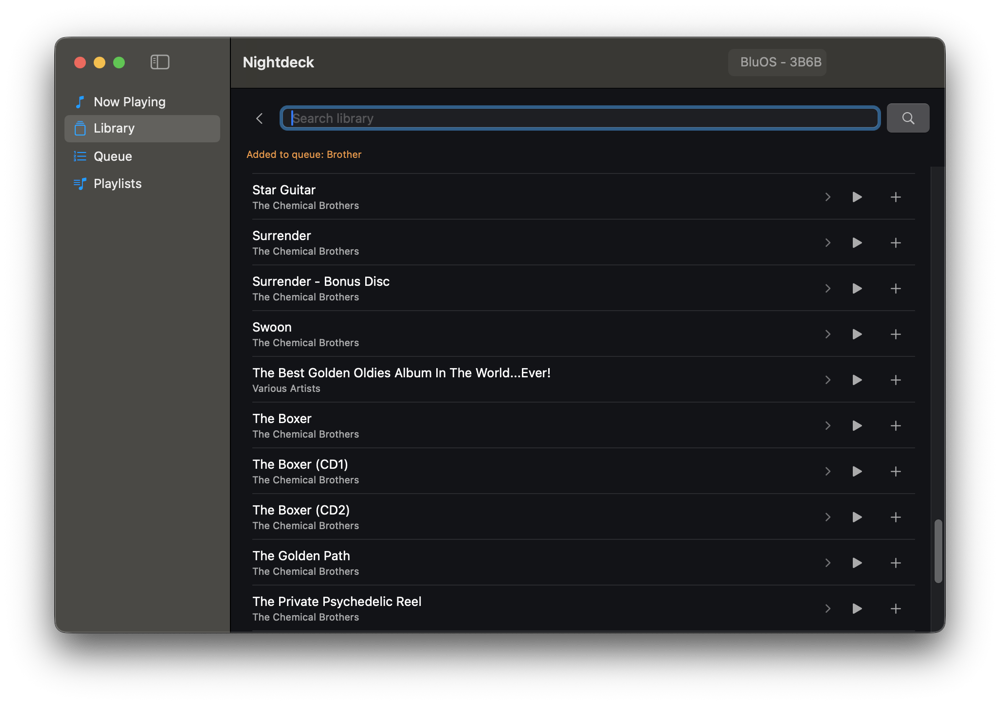
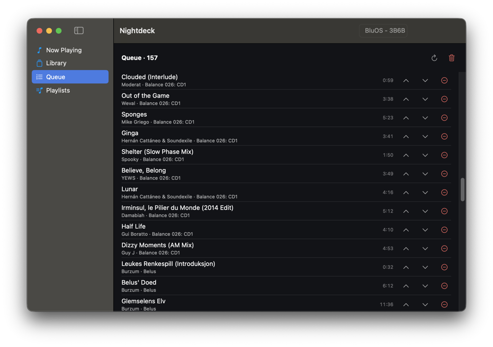

# Nightdeck

Nightdeck is a native macOS player for BluOS. Version 1.0.0 talks to a player over HTTP on port 11000, the same local API as [bluplay](https://github.com/fredrikspang-sys/bluplay).

## Download

Download `Nightdeck-1.0.0-macOS.zip` from [Releases](https://github.com/fredrikspang-sys/nightdeck/releases), unzip it and move `Nightdeck.app` to Applications.

The app is ad-hoc signed and not notarized, so macOS blocks it the first time. Right-click `Nightdeck.app` and choose Open, then confirm. On newer macOS versions you may need to allow it under System Settings > Privacy & Security instead. You can also remove the quarantine flag in Terminal:

```sh
xattr -dr com.apple.quarantine /Applications/Nightdeck.app
```

## Requirements

- macOS 14 or later
- Swift 6 Command Line Tools
- No Xcode and no third-party packages

## Build and run

```sh
swift build -c release
scripts/make-app.sh
open build/Nightdeck.app
```

`scripts/make-app.sh` builds with `-Osize` and dead-strips, then assembles `build/Nightdeck.app` (bundle id `no.spang.nightdeck`) and ad-hoc signs it.

No player is selected until you pick one. The window header and the menu bar list players found with Bonjour (`_musc._tcp`, `_musp._tcp`, `_musz._tcp`) plus addresses you save as `host` or `host:port`. Settings can connect to a host directly. Port 11000 is the BluOS default. Choosing a player is what switches the connection.

The player you are controlling is the group master. Group and Ungroup add or remove another player. Now playing shows the group, for example `+ Kitchen`.

Buttons send real commands to the selected player. Play, pause, skip, volume, and queue changes are not read-only.

## Tests

```sh
swift test
```

Tests start `scripts/mock_bluos.py` (Python 3, standard library only) on `127.0.0.1` and talk to that. They do not contact a player on the network. `swift test` on Command Line Tools loads the Testing macros plugin from the Command Line Tools directory. `swift build` does not need it.

## Features

- Now playing: cover art, title, artist, album, seek, play/pause, previous, next, volume, shuffle, repeat
- Library browse (artists, albums, tracks) and search, paged as the player pages
- Queue: play, reorder, remove, clear, add an album or track, play now
- Saved playlists and presets
- Sleep timer with a volume fade, then pause or stop
- Media keys and Now Playing in Control Center
- Optional menu-bar controls
- Several players, and sync groups on the active player
- Long-poll of `/Status` (etag and timeout). The progress bar moves locally between updates

## Screenshots







## Disclaimer

Nightdeck is an independent project. It is not affiliated with, endorsed by, or supported by Bluesound, NAD Electronics, or Lenbrook Industries. BluOS, Bluesound, and NAD are trademarks of their respective owners. Nightdeck uses the player's local HTTP API. Use it at your own risk.

## License

MIT. See [LICENSE](LICENSE).
